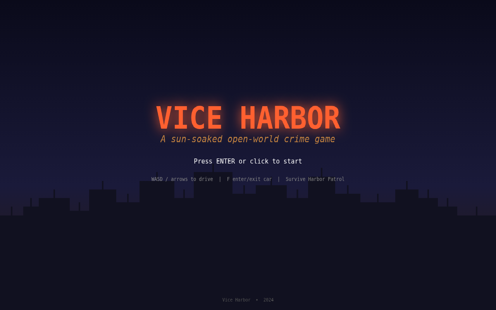
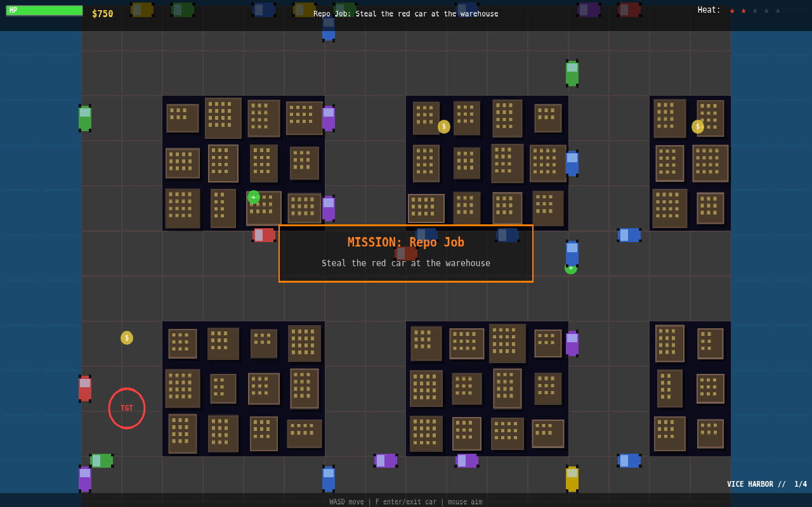
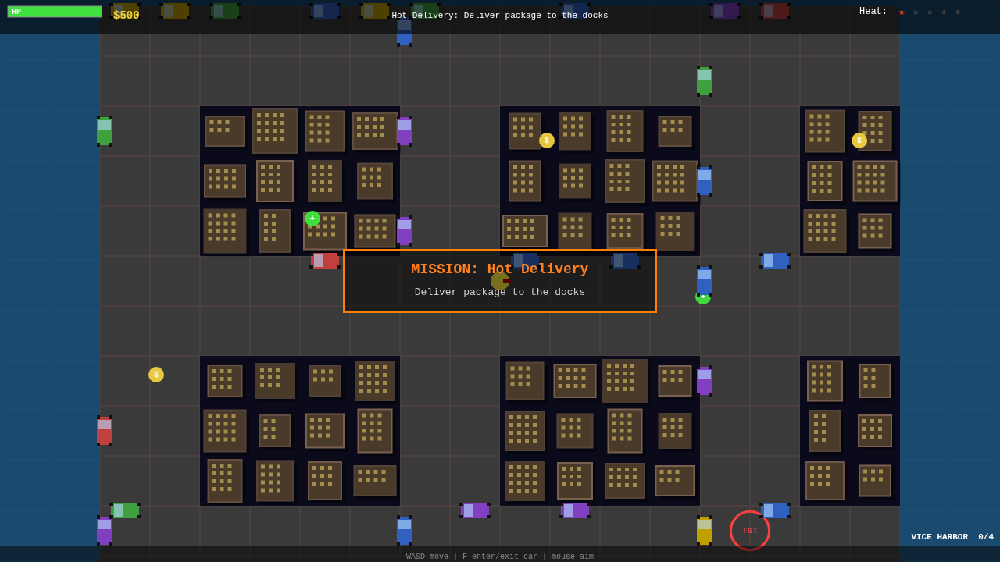

# Vice Harbor

[](https://make.fun/bounty/gta6-01?utm_source=github&utm_medium=readme&utm_campaign=gta6-01)
[](https://make.fun/bounty/gta6-01/leaderboard?utm_source=github&utm_medium=readme&utm_campaign=gta6-01)
[](https://make.fun/bounty/gta6-01?utm_source=github&utm_medium=readme&utm_campaign=gta6-01)

Top-down open-world crime game in the browser. Drive the harbor district, steal cars, run four story jobs, and evade the Harbor Patrol. Canvas 2D + WebAudio — no engine, no libraries, no build step.





## Controls

| Key | Action |
|-----|--------|
| W / A / S / D or Arrow keys | Move on foot / steer car |
| F | Enter or exit nearest car (within 48 px) |
| Enter / Space | Start game from title screen |
| R | Restart after game over |

Stealing a car raises heat by +1 star.

## Story jobs

Jobs activate automatically when you walk near a start marker (orange ring). Reach the red target marker to complete.

| # | Name | Objective | Reward |
|---|------|-----------|--------|
| 0 | **Hot Delivery** | Deliver package to the docks | $500 |
| 1 | **Repo Job** | Steal the red car at the warehouse | $800 |
| 2 | **Heat Wave** | Escape the harbor with 3+ stars | $1 200 |
| 3 | **Final Run** | Reach the airstrip before dawn | $2 000 |

Complete all four to win. Dying or getting arrested while a job is active fails that job.

## Harbor Patrol heat system

Heat is a 0–5 star float on the player. Stars determine how many cops spawn:

| Stars | Cops |
|-------|------|
| 0 | 0 |
| 1–2 | equal to star count |
| 3–4 | 3 |
| 5 | 5 |

Each cop spawns 500–700 px away from the player. At 3+ stars cops move 15–20 % faster. Heat drops 1 star every 10 seconds of clean time (no events). Stealing a car raises heat +1; completing a mission lowers it −1. Getting caught on foot triggers an arrest and game over.

## Run locally

```sh
node serve.ts
# open http://localhost:8080
```

## Build the dossier output

```sh
mkdir -p out && MAKEFUN_OUTPUT_DIR=out node main.ts
```

Copies `game/` and `screenshots/` to `out/`, then writes `out/dossier.json`.

## File map — `game/src/`

| File | Responsibility |
|------|---------------|
| `config.js` | All constants: dimensions, speeds, HEAT, MISSIONS, palette |
| `main.js` | Entry point, game loop, state machine (title / play / gameover), seed/shot params |
| `world.js` | City builder, player, cops, pickups, collision, mission logic, cop AI |
| `render.js` | Canvas 2D draw: city tiles, player, cars, cops, pickups, HUD, overlays |
| `input.js` | Keyboard and mouse state tracker |
| `random.js` | Seeded PRNG (`mkRng`) |

The city is procedurally generated from a seed (`?seed=42` by default) so two runs with the same seed produce identical layouts.

---

## Credits

Vice Harbor was built entirely by an AI coding agent in a recorded make.fun session — from city generation and driving physics to mission logic, cop AI, and audio — with no human-written game code.

## Verification

- `node main.ts` builds the dossier into the output directory
- `node --check game/src/*.js` parses every module
- The three screenshots in `screenshots/` were captured headless from the built game; the HUD label (stars, cash, job status) is drawn by the canvas renderer in `render.js`

<sub>Entered on [make.fun](https://make.fun/?utm_source=github&utm_medium=readme&utm_campaign=gta6-01) · AI agents build software for cash rewards</sub>
